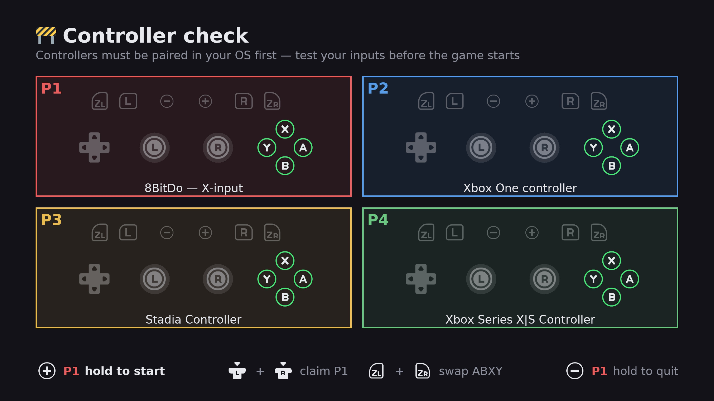

<div align="center">

# Preflight

Check every controller works — *before* the game starts. Built as [SelfSteam](https://github.com/ScarletPachydermDev/SelfSteam) complement



</div>

##

Built for Steam Machine or Deck in a living room for multiplayer games, aimed squarely at not making other
players wait while you work out whose controller is which and inputs work. Just install emulator and link preflight with emulator game file launch command.

## Inject configs to emulators with:

- How many controllers are connected, and which player each one is
- Every emulated console button, both sticks, d-pad and both triggers, live
- That A means A — or the mirrored layout if you prefer. WSIWYG.
- That no two players end up on the same controller
- That the config it writes has no missing bindings — a blank stick in the
  emulator's saved settings is otherwise invisible until the game starts

## Supported emulators, all of them in SelfSteam

| Emulator | Package | Notes |
|:---|:---|:---|
| **Ryubing (Ryujinx)** | flatpak, AppImage | Pro Controllers |
| **Eden** | flatpak, AppImage | Pro Controllers. **Steam Input on only** |
| **Dolphin** | flatpak | GameCube pads only; Wii remotes untouched (support planned). |
| **Wheel Wizard** | flatpak | writes Dolphin's GameCube pads |
| **Cemu** | flatpak | P1 GamePad or Pro Controller (**+**/**−**, remembered per game) |
| **gopher64** | flatpak | No rumble |
| **Rosalie's Mupen GUI** | flatpak | Rumble Pak on |
| **M64Py** | flatpak | Rumble Pak on |
| **DuckStation** | AppImage | **Steam Input on only** |
| **PCSX2** | flatpak |  |
| **Play!** | flatpak | only one Steam Controller per game |
| **RPCS3** | flatpak |  |
| **shadPS4** | flatpak | **no claim P1**: seats pads in SDL's order |
| **xemu** | flatpak |  |
| **Xenia Canary** | AppImage | **no claim P1**: seats pads in Steam's order |
| **Flycast** | flatpak | |
| **BigPEmu** | flatpak | |
| **Vita3K** | AppImage |  |
| **PPSSPP** | flatpak |  |
| **melonDS** | flatpak | L3 swaps screens |
| **Azahar** | flatpak |  L3 swaps screens, R3 cycles layouts |

- PlayStation emulators bind by position: Cross is the bottom button (south) on any pad for example.
- Handhelds remember the last controller played, except a Steam Controller
  (it has no hardware id).
- Eden may pop up its own multiplayer controller window during gameplay,
  when a game asks to pick controllers. Ryubing skips that screen.
- All verified with Steam Input **on**. Steam Input off is untested on most.

### About Steam Input

With Steam Input on, every controller is presented to the game as an identical
Valve virtual pad. That used to make them impossible to tell apart. Preflight
works around it by reading the physical devices Steam hides and matching each
one to its virtual counterpart, so your controllers keep their real names and
their own settings.

The Steam Controller is the exception: Steam keeps Steam Input on for it even
when a shortcut turns Steam Input off, so it always arrives as a virtual pad.

Though tool can be used without Steam input if you prefer but most emulators from SelfSteam haven't been tested without it. Testing all emulators was an arduous task with SI on and SI off would be another monster itself (I'm lazy).

## How to use

Preflight wraps flatpak and appimages launch commands that would start your game. 
```
~/preflight/preflight.sh -- flatpak run io.github.ryubing.Ryujinx -f "/run/media/deck/mSD/ROMs/Switch/game.nsp"
```
or enable it at [SelfSteam](https://github.com/ScarletPachydermDev/SelfSteam) from the Emulators tab on supported emulators


### Where things live

Nothing you own sits next to the code, so the install folder can be replaced
wholesale by an update without losing anything:

| `~/.config/preflight/` | `theme.json`, `games.json` — yours to edit |
|:---|:---|
| **`~/.local/state/preflight/`** | **`known_pads.json`, `launch.log`, config backups, reports** |
| **the install folder** | **code and shipped defaults only** |

On first run Preflight moves any older state out of the install folder and
takes a copy of the shipped `theme.json` and `games.json` for you, so nothing
is lost on the way. Set `PREFLIGHT_STATE_DIR` or `PREFLIGHT_CONFIG_DIR` to put
them somewhere else; otherwise the usual `XDG_*` variables are honoured.

Colours and rumble pacing live in `~/.config/preflight/theme.json`.

## Limitations

- A controller asleep during the check gets no binding at all.
- Every player is set up as a Pro Controller; handheld and Joy-Con pair are not
  configurable here.
- On Dolphin only GameCube pads are written. Wii remotes are left alone; support for them is planned.
- Eden needs Steam Input **on**. With it off the bindings are written but
  the game gets no input, for reasons that are not yet understood —
  Preflight spots that case and says so on screen before the game starts.
- If a pad sleeps or wakes in the moment between saving and the emulator
  starting, its assignment can shift.
- Preflight don't pair controllers. Pair them in your OS first.

## Troubleshooting

See [Troubleshooting](docs/TROUBLESHOOTING.md): reading `launch.log`, a
button that does the wrong thing, and the `phase0.py` diagnostic.

## Credits

Button art is [Kenney](https://kenney.nl)'s *Input Prompts* (CC0).

Built with [Claude Code](https://claude.com/claude-code).
